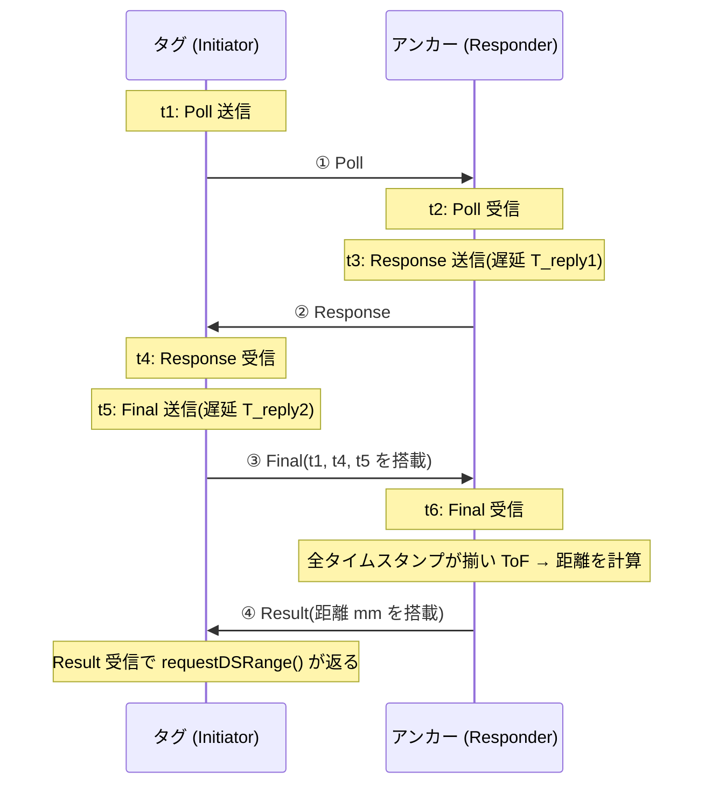

# DS-TWR測距方式詳細設計書

- 作成日: 2026-08-15
- ステータス: ドラフト(実装前レビュー用)
- 上位文書: [rtls-design.md](rtls-design.md) §2(**採用方式**)
- 関連文書: [ss-twr-design.md](ss-twr-design.md)(予備方式)、[tdoa-design.md](tdoa-design.md)(将来方式)

## 1. 位置づけ

DS-TWR(Double-Sided Two-Way Ranging)は本システムの**標準測距方式**。本書はその原理、公式ライブラリでの実装仕様、タイミング設計、誤差予算を定める。

## 2. 測距原理

### 2.1 メッセージ交換(4メッセージ方式: Poll / Response / Final / Result)



ToFの計算は**アンカー側**で行い、距離はResultフレームでタグへ返す。公式ライブラリの`requestDSRange()`はResultを受信して初めて成功を返すため、1交換の所要時間・エアタイムにはResultの送受信も含まれる(§3.3の`resultRxAfterFinalTxDelayUus`、`resultRepeatCount`)。

### 2.2 ToF計算式

タグ側往復`T_round1 = t4 − t1`、アンカー側応答遅延`T_reply1 = t3 − t2`、アンカー側往復`T_round2 = t6 − t3`、タグ側応答遅延`T_reply2 = t5 − t4`として:

```
ToF = (T_round1 × T_round2 − T_reply1 × T_reply2)
      ─────────────────────────────────────────────
      (T_round1 + T_round2 + T_reply1 + T_reply2)

距離 d = c × ToF   (c = 299,792,458 m/s。1 ns ≈ 30 cm)
```

この計算はアンカーが行い(t1, t4, t5はFinalで受け取る)、得られた距離をResultでタグへ通知する。

### 2.3 クロックドリフト誤差の相殺(DS-TWRを採用する理由)

タグ・アンカーの水晶に周波数偏差e_T, e_A(各 ±20 ppm程度)があっても、上式は**両側の往復を掛け合わせる対称形**のため、1次のドリフト誤差が相殺される。残留誤差は近似的に

```
err ≈ ToF × (e_T + e_A) / 2      (例: ToF 100 ns × 40 ppm / 2 = 2 ps → 距離換算 ≈ 0.6 mm)
```

と無視できる。SS-TWRと違って応答遅延T_replyにドリフトが乗らないため、**µs級のホスト処理遅延があっても精度が保たれる**。これがホストMCU(Arduinoループ)経由で制御する本構成にDS-TWRが適する本質的な理由である。

## 3. ライブラリ実装仕様

### 3.1 使用API

| 役割 | API | 備考 |
|---|---|---|
| タグ | `requestDSRange(M5Stamp_UWBDSRangeConfig)` → `M5Stamp_UWBDSRangeResult` | ブロッキング呼出し(Poll送信 → Result受信まで)。結果に距離(mm/m、Resultフレーム経由)・シーケンス番号・成否 |
| アンカー | `respondDSRange(M5Stamp_UWBDSRangeConfig)` → `M5Stamp_UWBDSResponderResult` | ループで呼び続け、自局宛Pollに応答。ToF計算とResult送信まで担当し、結果にも距離が入る |

### 3.2 フレーム・アドレス設定

- PAN ID `0xDECA`、アドレス体系は基本設計 §4.2(アンカー`0x0010`〜、タグ`0x0001`〜)。
- タグは測距のたびに`DSRangeConfig`の相手アドレスを巡回リストの次のアンカーに差し替えて`requestDSRange()`を呼ぶ(基本設計 §4.4)。
- PHY設定はChannel 9 / BPRF / **850 kbps / プリアンブル256 / PAC16**(`rtls_common.h`の`makePhyConfig()`)。ライブラリ既定の6.8 Mbps / 128では成功率が15〜20% に留まったため変更した(§7)。全ノードで統一し、変更時は全ノード一斉更新とする。

### 3.3 タイミングパラメータ(公式サンプル準拠 → Step 1実測で確定)

| パラメータ(ライブラリ設定名 / 本プロジェクトの定数名) | 初期値 | 説明 |
|---|---|---|
| `responseTxDelayUus` / `kDsResponseTxDelayUus`(アンカー) | 3000 µs | Poll受信 → Response送信の遅延。**1500 µsでは遅延送信が間に合わず(`TX_START_FAILED`)成功率35% のため、3000 µsで確定**(§7) |
| `finalTxDelayUus` / `kDsFinalTxDelayUus`(タグ) | 2600 µs | Response受信 → Final送信の遅延。**1800 µsではアンテナの向き次第で遅延送信が間に合わず(`TX_START_FAILED`)成功率2% に落ちたため、2600 µsに延ばした**(§7.4) |
| `rxTimeoutUus` / `kDsRxTimeoutUus` | 3000 µs | 各受信待ちの上限 |
| `hostTimeoutMs` / `kDsHostTimeoutMs` | 100 ms | `requestDSRange()`全体の上限 |
| `resultRxAfterFinalTxDelayUus` / `kDsResultRxAfterFinalTxDelayUus`(タグ) | 500 µs | Final送信 → Result受信待ち開始までの遅延 |
| `resultRepeatCount` / `kDsResultRepeatCount`(アンカー) | 1 回 | アンカー→タグのResultフレーム再送回数。ライブラリ既定は3だが、タグは最初のResultで次アンカーのPollへ移るため余分な再送は次の交換と衝突する。公式`DS_TWR_MULTI_ANCHOR`例に合わせて1 |
| `resultRepeatGapMs` / `kDsResultRepeatGapMs` | 3 ms | Result再送間隔(再送1回では未使用) |
| — / `kDsInterAnchorGapMs`(タグ) | 2 ms | 巡回中のアンカー切替ギャップ。前アンカーがTX→RXに戻る猶予(公式例は20 ms。4台 × 20 msではスロット予算を超えるため、Step 1で最小値を実測) |
| 1交換の所要時間 | **成功時 p50 8.3 ms / p95 9.3 ms**(実測) | 失敗時はタイムアウトで打ち切られ、最大11.2 ms。TDMAスロット設計(基本設計 §4.4)の根拠(§7) |

現在の確定値は`firmware/lib/rtls_common/rtls_common.h`の`kDs*`定数を正とする(この定数がライブラリ設定の各フィールドへ代入される)。

**遅延パラメータの方針**: 短くするほどエアタイムは減るが、ホスト(Arduinoループ+SPI)の応答ジッタでタイムアウト率が上がる。Step 1で「成功率99% を保てる最小値」を求め、`rtls_common`の共有ヘッダに定数として固定する。

### 3.4 リトライとエラー処理

- 1アンカーにつき失敗時リトライ1回(乱数バックオフ1〜5 ms)。それでも失敗なら当該サイクルは欠測(基本設計 §4.4)。
- アンカー側の`RangeFrameMismatch`は「他アンカー宛のPollを受信した」事象で、多アンカー環境では毎サイクル発生する正常動作。統計では`ignored`として`err`と区別する(公式`DS_TWR_MULTI_ANCHOR`例と同じ扱い)。
- `lastError()`の種別(タイムアウト / CRC / チップ異常)をタグの統計に集計し、MQTT統計(A案 §12)へ流す。チップ異常が連続する場合は`hardReset()` → `begin()`で復帰を試みる。

## 4. 誤差予算と対策

| 誤差要因 | 大きさ(目安) | 対策 |
|---|---|---|
| 測距ノイズ(LoS) | σ ≈ 5〜10 cm(仕様誤差0.14 m) | カルマンフィルタで平滑化(server-design.md §5) |
| アンテナ遅延オフセット | 数十cm(個体差) | ノード別`bias_mm`校正(基本設計 §6) |
| クロックドリフト | < 1 mm(§2.3で相殺) | 対策不要 — DS-TWRの利点 |
| NLoS(遮蔽・マルチパス) | +0.3〜数m(伸びる方向) | 残差ベース外れ値除去 + ゲーティング(server-design.md §5) |
| 温度による遅延変動 | 数cm | 定期再校正(季節単位)で十分 |
| アンカー座標誤差 | 設置測量に依存 | ±3 cm以内で測量(基本設計 §3.3) |

## 5. TDMAとの統合

基本設計 §4.4のスロット(90 ms)内で4アンカー × (1交換 + リトライ)を実行する。本方式固有の考慮:

- **交換中の割込み耐性**: DS-TWRは4メッセージが揃って1測距。他タグの電波はアドレス不一致で無視されるが、交換中の衝突はFinalまたはResultの喪失として現れる。リトライで吸収し、スロット同期(±10 ms、基本設計 §4.9)で衝突自体を稀にする。
- **アンカー側は常時`respondDSRange()`ループ**であり、どのタグのPollにも(自局宛なら)応答する。アンカーにスロットの概念は不要 — タグ側の規律だけでTDMAが成立する。

## 6. テスト計画(ロードマップStep 1に対応)

1. **静的精度**: 既知距離1 / 5 / 10 / 20 / 40 m(LoS)で各1000回測距。平均誤差(→ bias校正値)と σ を記録。受入: 校正後 |平均誤差| ≤ 5 cm、σ ≤ 10 cm。
2. **タイミング実測**: 1交換の所要時間分布(p50/p95/p99)と、`response_delay`を3000 → 1500 µsへ詰めた際の成功率変化。TDMAスロット幅の根拠データとする。
3. **成功率vs距離**: 5 m刻みで成功率を測り、実効レンジ(成功率95% を保てる距離)を求める。セル寸法(15〜25 m)の妥当性を確認。
4. **干渉試験**: 2タグが同時に同一アンカーへPollする最悪ケースを意図的に作り、失敗がタイムアウトとして安全に現れる(誤距離が出ない)ことを確認。
5. **アンカー間ギャップ**: アンカー4台を巡回し、`kDsInterAnchorGapMs` を 0 / 2 / 5 / 20 msで振って成功率とサイクル時間(p95)を測る(`tag_step1`の`TARGET_ANCHORS`指定)。成功率を落とさない最小値を採用し、4アンカー分のサイクルp95がスロット有効幅90 msに収まることを確認する。

## 7. 実測記録

Issue [#1](https://github.com/atinfinity/m5stamp_uwb_rtls/issues/1)。2台(アンカー0x0010 / タグ0x0001、`tag_step1`)を約0.75 mで固定し、条件ごとに1000回測距した。実距離は未計測のため、距離は生の平均値(bias校正前)。

### 7.1 PHY設定

| PHY | 成功率 | 主なエラー | 平均距離 | σ | 交換時間p50 |
|---|---|---|---|---|---|
| 6.8 Mbps / プリアンブル128(ライブラリ既定) | 14.8% / 19.9% | RX_TIMEOUT, RX_ERROR | 0.760 / 0.741 m | 3.1 / 3.0 cm | 7.3 ms |
| 850 kbps / 128 | 73.0% | RX_TIMEOUT×176, RX_ERROR×94 | 0.746 m | 3.1 cm | 7.3 ms |
| **850 kbps / 256 / PAC16(採用)** | **87.0% / 86.6% / 86.8%** | RX_TIMEOUT×81, RX_ERROR×51 | 0.751 / 0.748 / 0.752 m | 2.9〜3.2 cm | 8.3 ms |
| 850 kbps / 512 / PAC16(Final遅延2600 µs) | 88.2% | RX_TIMEOUT×72, RX_ERROR×46 | 0.740 m | 3.1 cm | 9.3 ms |

- 6.8 Mbpsではデータ部の復号失敗(Reed-Solomon同期外れ)が支配的で、4メッセージが揃う必要のあるDS-TWRは特に影響が大きい(原因の切り分けはtdoa-design.md §7.2)
- プリアンブル512はFinal遅延1800 µsのままだとタグの遅延送信が間に合わない(`TX_START_FAILED`)。2600 µsに延ばせば動くが、256との差は1ポイントのため採らない(Final遅延は後に256でも2600 µsにした。§7.4)
- 平均距離はPHYによらず±1 cm程度で一致する。PHY変更でbiasはほぼ変わらない
- 0.75 mでも成功率は87% 程度。フレームあたり約3.5% の取りこぼしが残る。受入の目安(95%)には届かないため、リトライ(§3.4)で吸収する前提とし、アンテナの向きや筐体の影響は距離別の実測で確認する

### 7.2 応答遅延(`kDsResponseTxDelayUus`)

850 kbps / 256で、3000 µsと1500 µs(Response受信待ち開始`kDsResponseRxAfterTxDelayUus`は700 µs)を比較した。

| 応答遅延 | 成功率 | エラー | 交換時間p50 |
|---|---|---|---|
| 3000 µs | 86.6% | RX_TIMEOUT×93, RX_ERROR×41 | 8.3 ms |
| 1500 µs | 35.5% | **TX_START_FAILED×553**, RX_TIMEOUT×63, RX_ERROR×29 | 7.3 ms |

1500 µsではアンカーのホスト処理(Poll受信 → SPI → 遅延送信設定)が間に合わない。短縮できるのは1 ms程度で、成功率の低下に見合わないため、3000 µsで確定とする。

### 7.3 TDMAスロットへの反映

Final遅延2600 µs(§7.4)での実測: 成功した交換はp50 8.3 ms / p95 9.3 ms、失敗した交換はタイムアウトで打ち切られ最大11.2 ms。スロット1つ(4アンカー)の所要時間を見積もる:

- リトライなし: 4 × 9.3 + アンカー間ギャップ 3 × 2 = **約43 ms**
- 全アンカーで1回ずつリトライ(最悪): 4 × 11.2 + 4 × 9.3 + 3 × 2 + バックオフ 4 × 最大5 = **約108 ms**。スロット有効幅90 msを超える

交換あたりの成功率87% では、1サイクルの平均リトライ数は約0.5回で、4台すべてがリトライになる確率は約0.03%。通常は有効幅90 ms(基本設計 §4.4)に十分収まる。最悪ケースはバックオフの短縮だけでは収まらないため、スロット残り時間が足りないときはリトライを打ち切って欠測とする(タグ側でスロット内の経過時間を見る)。アンカー間ギャップの最小値は、4アンカー構成での実測(§6の5.)で確定する。

### 7.4 Final遅延(`kDsFinalTxDelayUus`)

Issue [#60](https://github.com/atinfinity/m5stamp_uwb_rtls/issues/60)の実測中、2台を約20 cmに置いてアンテナの向きを変えたところ、1800 µsでは`TX_START_FAILED`が多発した(タグ側、Response受信 → Final遅延送信が間に合わない)。各1000回:

| 向き | Final遅延 | 成功率 | エラー |
|---|---|---|---|
| A | 1800 µs | 82.4%(6000回) | RX_TIMEOUT×702, RX_ERROR×357 |
| B | 1800 µs | **2.0%** | **TX_START_FAILED×873**, RX_TIMEOUT×61, RX_ERROR×46 |
| B | 2600 µs | 77.6% | RX_TIMEOUT×140, RX_ERROR×84 |

向きで発生が変わる理由は未解明だが、1800 µsはホスト処理に対して余裕がない。2600 µsで`TX_START_FAILED`は0件になったため、これを確定値とする。交換時間の増分は成功時p95で約1 ms。

### 7.5 未了

- 静的精度(既知距離でのbias / σ)、成功率vs距離: 巻尺での実測が必要(Issue [#60](https://github.com/atinfinity/m5stamp_uwb_rtls/issues/60))
- 干渉試験: 3台目(2タグ目)が必要
