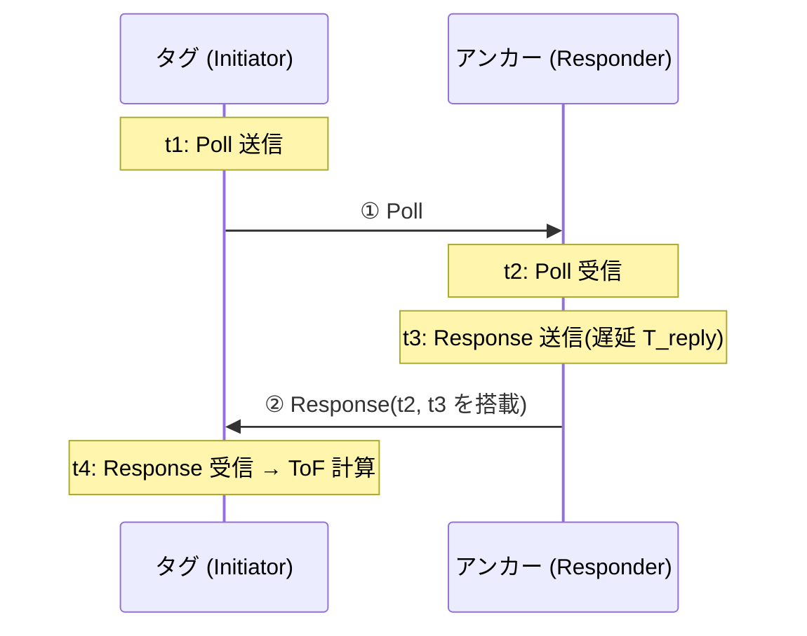

# SS-TWR測距方式詳細設計書

- 作成日: 2026-08-15
- ステータス: ドラフト(実装前レビュー用)
- 上位文書: [rtls-design.md](rtls-design.md) §2(**予備方式** — エアタイム逼迫時の代替)
- 関連文書: [ds-twr-design.md](ds-twr-design.md)(採用方式)、[tdoa-design.md](tdoa-design.md)(将来方式)

## 1. 位置づけ

SS-TWR(Single-Sided Two-Way Ranging)は2メッセージで完結する軽量なTWR。**標準方式はDS-TWR**とし、SS-TWRは次の条件で切り替える予備方式として設計しておく。

- タグ数・更新レートを上げて**UWBエアタイムが逼迫**した場合(交換時間 ≈ 2/3に短縮)
- タグの電池持ちを優先し、送受信回数を減らしたい場合

**切替の前提条件(§4)を満たすことを実測で確認できるまで、本方式は投入しない。**

## 2. 測距原理

### 2.1 メッセージ交換(2メッセージ方式)



### 2.2 ToF計算式と本質的弱点

```
ToF = (T_round − T_reply) / 2        T_round = t4 − t1, T_reply = t3 − t2
```

タグとアンカーのクロック偏差の差 Δe(= e_T − e_A)があると、T_replyの計測が両ノードで食い違い、誤差が**応答遅延に比例して**乗る:

```
err ≈ Δe × T_reply / 2
```

具体値: 各水晶 ±20 ppm(最悪 Δe = 40 ppm)、T_reply = 3000 µsのとき

```
err ≈ 40e-6 × 3000 µs / 2 = 60 ns  →  距離誤差 ≈ 18 m(!)
```

**つまり補償なしのSS-TWRは、本構成のようにホスト遅延でT_replyがms級になる場合、実用にならない。** 成立させるには次のいずれかが必須:

1. **クロックオフセット補償(CFO補正)**: QM33120Wは受信キャリアからクロック偏差比を推定できる(IEEE 802.15.4z系デバイスの標準機能)。Response受信時の偏差推定値で`T_reply`を補正すれば、残留誤差はcm〜dm級に落ちる。**公式ライブラリの`requestRange()`はこれを行わない(実機で確認、§7)。** そのためタグ側でResponse受信直後に`dwt_readclockoffset()`を読み、距離へ c × T_reply × ratio / 2 を加えて補正する(`rtls_ss_cfo.h`)。
2. **T_replyの最小化**: 補償が使えない場合、T_replyを µs級(チップ内自動応答)まで詰める必要があるが、ホストMCU経由の本構成では現実的でない。

## 3. ライブラリ実装仕様

| 役割 | API | 備考 |
|---|---|---|
| タグ | `requestRange(M5Stamp_UWBRangeConfig)` → `M5Stamp_UWBRangeResult` | 公式サンプル`SS_TWR_TAG`準拠 |
| アンカー | `respondRange(M5Stamp_UWBRangeConfig)` → `M5Stamp_UWBResponderResult` | `SS_TWR_ANCHOR`準拠 |

- アドレス・PAN・PHY設定、リトライ方針、TDMA統合は**DS-TWR設計(ds-twr-design.md §3.2, §3.4, §5)と同一**。タグの巡回ループで呼ぶ関数が`requestDSRange` → `requestRange`に変わるだけにする(`ranging.cpp`内で方式をビルドフラグではなく**設定値**で切替可能にし、フィールドでA/B比較できるようにする)。
- タイミング初期値: `responseTxDelayUus`(定数`kSsResponseTxDelayUus`)3000 µs、RXタイムアウト(`kSsRxTimeoutUus`)4500 µs(公式サンプル準拠。確定値は`rtls_common.h`の`kSs*`定数を正とする)。
- アンカー間ギャップ(`kSsInterAnchorGapMs`)は**5 ms**。DS-TWRの`kDsInterAnchorGapMs`(2 ms)とは別に持つ。2 msでは切替の余裕が足りなかった(§7.1)。

## 4. DS-TWRからの切替判断

| # | 前提条件(すべて実測で確認) | 検証方法 |
|---|---|---|
| ① | クロックオフセット補償(ライブラリにはないためタグ側で実施、§2.2)込みで、静的誤差が**σ ≤ 15 cm・バイアス ≤ 10 cm**に収まる | §6の1. の静的試験をDS-TWRと並べて実施 |
| ② | SS-TWRの1交換所要時間がDS-TWR比で**30% 以上短い** | §6の2. タイミング実測 |
| ③ | 精度低下がシステム要件(CEP50 ≤ 30 cm)を壊さない | 同一ログ・リプレイでA案パイプラインのCEPを比較 |

判断基準の目安: **タグ×更新レートの積が「5台 × 2 Hz」を超える拡張**(例: 5台 × 4 Hz、10台 × 2 Hz)を求められた時に検証を開始する。それ以下ならDS-TWRのまま。

## 5. エアタイム比較(切替の効果見積もり)

| 項目 | DS-TWR | SS-TWR | 備考 |
|---|---|---|---|
| メッセージ数/測距 | 4(Poll / Response / Final / Result) | 2(Poll / Response) | DS側は距離をアンカーが計算しResultで返す(ds-twr-design.md §2.1) |
| 1交換の所要時間 | ~T(実測、5〜10 ms見込み) | ~0.5〜0.6T(実測で置換) | FinalとResultの送信・受信待ちが消える。SSはResponseに載ったt2, t3からタグ側で計算する |
| スロット幅(4アンカー+リトライ) | 90 ms | ~60 ms | スーパーフレーム500 msなら**8タグ**まで、またはタグ5台のまま **~3 Hz**に向上 |
| タグ送信回数/測距 | 2回 | 1回 | 電池持ちに寄与 |

## 6. テスト計画

1. **静的精度(DS-TWRと対照)**: 既知距離1 / 5 / 10 / 20 mで各1000回、DS-TWRと同条件で測距し、バイアス・σ・温度依存(始動直後vs 30分後)を比較。クロックオフセット補償の有無はここで判明する(補償なしならm級誤差が出る)。
2. **タイミング実測**: 1交換のp50/p95を計測し、§5の短縮率を実測値に置き換える。
3. **方式切替試験**: 運用中に設定変更(`rtls/config/tuning`経由)でDS→SSを切り替え、解算パイプライン(A案)が`bias_mm`再校正だけで追従できることを確認(方式ごとにバイアスが異なる可能性があるため、**biasテーブルは方式別に持つ**)。

## 7. 実測記録

Issue [#14](https://github.com/atinfinity/m5stamp_uwb_rtls/issues/14)。2台(アンカー0x0010 / タグ0x0001)を同じ配置のまま、DSとSSを交互に各1000回測距した。実距離は未計測で約0.75 m。以下の距離は生の平均値で、bias校正前。

| 方式 | 成功率 | 平均距離 | σ | 交換時間p50 |
|---|---|---|---|---|
| DS-TWR(1回目) | 14.8% | 0.760 m | 3.1 cm | 7.3 ms |
| SS-TWR(補償なし) | 47.8% | 1.487 m | 3.8 cm | 4.4 ms |
| SS-TWR(タグ側CFO補正) | 49.3% | 0.756 m | 5.7 cm | 4.4 ms |
| DS-TWR(2回目) | 19.9% | 0.741 m | 3.0 cm | 7.3 ms |
| SS-TWR(タグ側CFO補正、本実装) | 54.7% | 0.762 m | 5.8 cm | 4.4 ms |

- **CFO補償**: 補償なしのSSはDSより+73 cm長い。Response受信時のクロックオフセットは−1.285 ppm(σ 0.097 ppm)で、§2.2の式(1.3 ppm × 3.08 ms / 2 × c ≈ 0.6 m)と符号・大きさが合う。ライブラリの`requestRange()`はToFを(T_round − T_reply) / 2で計算するだけで、補償はしていない
- **補正後**: DSとの差は−0.4〜+2.1 cmで、DS自体の試行間差(1.9 cm)と同程度。σはオフセット推定のばらつき(0.1 ppm ≈ 4.5 cm)が加わり5.8 cmに増えるが、判定①のσ ≤ 15 cmには収まる。必要ならオフセットを移動平均すれば下げられる(オフセットは秒単位ではほぼ一定)
- **交換時間**: SSはDS比で40%短い(7.3 → 4.4 ms)。判定②(30%以上)を満たす
- **成功率**: 両方式とも低い。失敗の大半はRX_ERRORとRX_TIMEOUTで、TDoA PoCで見た6.8 Mbpsのデータ部復号失敗(tdoa-design.md §7.2)と同じ要因と見られる。メッセージ数の多いDSのほうが影響を受けやすい
- **PHY変更後**(850 kbps / プリアンブル256、ds-twr-design.md §7.1): SS-TWR(タグ側CFO補正)は成功率91.3%、平均0.816 m、σ 6.1 cm、交換時間4.4 ms。同じ配置のDS-TWR(86.8%、0.752 m)より6.4 cm長い。6.8 Mbpsのときの差(約2 cm)より大きいが、biasは方式別に校正する(§6の3.)ため判定には影響しない
### 7.1 2アンカー巡回とアンカー間ギャップ

3台(アンカー0x0010 / 0x0011、タグ0x0001)を机上に数十cm〜1 m離して置き、タグが2台のアンカーへ順にSS-TWRを行った(`tag_step1_ss`に`TARGET_ANCHORS=0x0010,0x0011`)。PHYは850 kbps / プリアンブル256。0x0011はモバイルバッテリー給電。アンカー間ギャップ(`INTER_ANCHOR_GAP_MS`、0x0010の交換終了から0x0011のPoll送信までの待ち)を振り、条件ごとに各アンカー1500回(2 msの1回目は2000回)。

| ギャップ | 0x0010(1台目) | 0x0011(2台目) | 0x0011の主なエラー | サイクル時間 p50 / p95 | 0x0011の失敗率(0x0010成功後 / 失敗後) |
|---|---|---|---|---|---|
| 0 ms | 92.1% | **29.5%** | RX_TIMEOUT×1050 | 11.1 / 11.1 ms | 69% / 88% |
| 2 ms(1回目) | 91.5% | 91.8% | RX_TIMEOUT×114, RX_ERROR×51 | 10.4 / 12.2 ms | 7.7% / 14.7% |
| 2 ms(2回目) | 90.7% | 91.8% | RX_TIMEOUT×83, RX_ERROR×40 | 10.4 / 12.2 ms | 8.0% / 10.0% |
| 5 ms | 90.5% | **94.5%** | RX_TIMEOUT×45, RX_ERROR×37 | 13.4 / 13.4 ms | 5.6% / 4.2% |
| 20 ms | 88.5% | 94.3% | RX_ERROR×44, RX_TIMEOUT×41 | 28.4 / 28.4 ms | 5.9% / 4.1% |

- **0 ms**は2台目がほぼ応答を受けられない(RX_TIMEOUT)。成功率は時間とともに2% → 85% と変わり(10% 区間ごと)、安定しない。切替直後の送受信の準備が間に合っていない
- **2 ms**は成功率は1台のとき(91.3%)と同程度だが、2台目の失敗が1台目の失敗の直後に偏る(独立なら差は出ない)。サイクル時間もばらつく(p95 12.2 ms)。切替の余裕がぎりぎり
- **5 ms以上**で偏りが消え、2台目の成功率は94% 台で頭打ちになる。サイクル時間も一定になる
- 1交換は4.4 msのまま(アンカー数で変わらない)。距離の中央値はギャップによらず0x0010が109〜123 mm、0x0011が184〜195 mm(実距離は未計測)
- **採用**: SS-TWRのアンカー間ギャップは**5 ms**(`kSsInterAnchorGapMs`)。4アンカーのサイクルは 4 × 4.4 + 3 × 5 ≈ 33 msで、スロット有効幅90 msに収まる(DS-TWRの2 msでの約43 msより短い)。DS-TWRの`kDsInterAnchorGapMs`(2 ms)も同じ傾向がないかは、DSで同じ比較をして確かめる(ds-twr-design.md §6の5.)

- **未了**: 実距離に対するbias(判定①の残り)と温度依存は、既知距離での実測で確認する。判定③(CEP比較)は2次元測位に必要なアンカー3台 + タグ(計4台)が揃ってから
